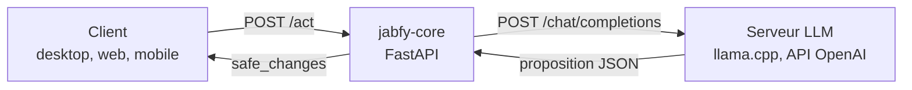

# jabfy-core

jabfy-core est le moteur d'orchestration de Jabfy : il reçoit une situation (« l'utilisateur rentre à la maison ») et l'état des appareils, demande à un LLM local de **proposer** des actions, puis les fait **vérifier de façon déterministe** avant de les renvoyer.

Le LLM ne contrôle jamais rien directement : il propose du JSON, le vérificateur décide.

## Rôle dans l'architecture



| Communique avec | Comment | Sens |
|---|---|---|
| Clients (desktop, web, mobile) | HTTP/JSON, CORS restreint à `JABFY_ALLOWED_ORIGINS` | entrant |
| Serveur LLM (llama.cpp ou tout serveur compatible OpenAI) | `GET /models`, `POST /chat/completions` | sortant |

jabfy-core n'est pas relié à jabfy-bus sur `main` : il utilise son propre mini-contrat de bus (voir [Interfaces](interfaces.md)).

## Pages

- [Installation et lancement](installation.md)
- [Fonctionnement interne](fonctionnement.md)
- [Interfaces](interfaces.md)
- [Tests](tests.md)

## Tests

```bash
pytest
```

30 tests unitaires, sans serveur LLM. Détail, couverture et conventions : [Tests](tests.md).

## État actuel et TODO

Périmètre V1 : Smart Home uniquement, aucun appareil réel n'est piloté.

Limites connues :

- le vérificateur ne contrôle que le registre d'appareils connus et les valeurs booléennes : pas de politiques, de permissions ni de limites de débit ;
- les appels au modèle sont synchrones et non streamés ;
- le bus ne gère que l'événement `user_situation` ;
- les modèles « raisonneurs » qui répondent dans `reasoning_content` laissent `content` vide, la proposition est alors rejetée ;
- `min_p` est ignoré par les serveurs qui ne l'implémentent pas.

À faire :

- déléguer la vérification à [jabfy-guard](https://github.com/jabfy-corp/jabfy-guard) (politiques, niveaux de risque, refus par défaut) ;
- brancher le vrai pipeline de [jabfy-bus](https://github.com/jabfy-corp/jabfy-bus) : un travail dans ce sens existe sur la branche `core-12-bus-integration`, non fusionnée dans `main`.
