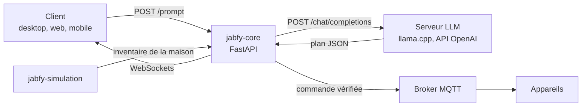

# jabfy-core

jabfy-core est le moteur d'orchestration de Jabfy. Il reçoit une demande (un prompt, ou un capteur qui change d'état), demande à un LLM local un **plan** d'actions, puis publie chaque commande sur le bus de jabfy-bus. Chaque commande est **vérifiée de façon déterministe** par jabfy-guard avant d'être envoyée à l'appareil en MQTT.

Le LLM ne contrôle jamais rien directement : il propose du JSON, la vérification décide.

## Rôle dans l'architecture



| Communique avec | Comment | Sens |
|---|---|---|
| Clients (desktop, web, mobile) | HTTP/JSON et WebSockets, CORS restreint à `JABFY_ALLOWED_ORIGINS` | entrant |
| Serveur LLM (llama.cpp ou tout serveur compatible OpenAI) | `GET /models`, `POST /chat/completions` | sortant |
| jabfy-simulation | `GET /api/ai/context` (inventaire de la maison) | sortant |
| Broker MQTT (Zigbee2MQTT) | abonnement aux capteurs, publication sur `<topic>/set` | les deux |

Le pipeline de jabfy-bus tourne dans le processus de jabfy-core. La vérification des commandes est déléguée à jabfy-guard.

## Pages

- [Installation et lancement](installation.md)
- [Fonctionnement interne](fonctionnement.md)
- [Interfaces](interfaces.md)
- [Intégration du bus et mode autonome](bus-integration.md) (en anglais)
- [Documentation du code, fichier par fichier](code/README.md)

## Tests

```bash
pytest
```

Les tests unitaires n'ont besoin d'aucun serveur LLM ni broker (clients injectables). Ils couvrent l'orchestrateur et les séquences, le journal des exécutions, le nettoyage des entrées, l'autorisation par jabfy-guard, la découverte de la simulation et le client OpenAI-compatible. La CI (`ci.yml`) les lance en Python 3.11 sur chaque PR vers `main`.

Le test d'intégration complet démarre Mosquitto dans Docker, le dépôt voisin `jabfy-simulation` et jabfy-core, avec une réponse de modèle fixe :

```bash
JABFY_INTEGRATION=1 pytest tests/integration
```

## État actuel et limites

Périmètre V1 : Smart Home uniquement, sur la maison virtuelle de jabfy-simulation.

- Les commandes partent uniquement sur le transport `zigbee` : les appareils du simulateur servis en HTTP ou Modbus ne sont pas pilotables depuis jabfy-core.
- Les politiques ne couvrent que les lumières, les interrupteurs et le thermostat, avec au plus 60 commandes par minute et par politique.
- Les exécutions sont traitées une par une ; le journal est en mémoire (100 dernières exécutions) et perdu au redémarrage.
- Les modèles « raisonneurs » qui répondent dans `reasoning_content` laissent `content` vide : la proposition est alors rejetée.
- `min_p` est ignoré par les serveurs qui ne l'implémentent pas.
- Les anciens modules `routes_actions.py` (`/act`), `verification.py`, `action_parser.py` et `prompt_builder.py` restent dans le dépôt mais ne sont plus utilisés par l'application.
