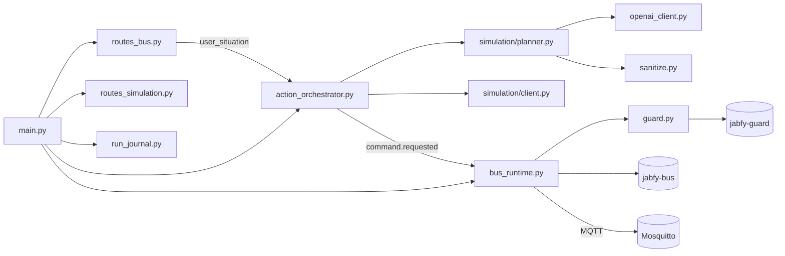

# jabfy-core — carte des fichiers

> Le cerveau : reçoit une situation, demande un plan au LLM, publie les commandes sur son bus interne.

Tests : [tests](tests.md) · build : [build et CI](build.md)

## Schéma

## À lire d'abord

1. [app/main.py](main.md) — Point d'entrée FastAPI : construit l'application, branche le bus en process, le journal des runs, l'orchestrateur et les routes.
2. [app/api/routes_bus.py](routes-bus.md) — Routes HTTP du mode headless : soumettre une situation (`POST /prompt`), suivre un run, lire l'état et vérifier l'audit.
3. [app/core/action_orchestrator.py](action-orchestrator.md) — Le cerveau du mode headless : reçoit les événements du bus, demande un plan au LLM et publie les commandes une par une, à l'heure.
4. [app/simulation/planner.py](simulation-planner.md) — Transforme une demande en plan : construit le prompt système avec l'inventaire, appelle le LLM, valide la réponse.
5. [app/core/bus_runtime.py](bus-runtime.md) — Héberge le pipeline jabfy-bus **dans le process** de Core et le relie à Mosquitto via paho-mqtt.
6. [app/core/guard.py](guard.md) — Adaptateur entre le bus et jabfy-guard : construit les règles guard depuis `config/bus.json` + l'inventaire, puis juge chaque commande.
7. [app/core/run_journal.py](run-journal.md) — Journal des runs : garde pour chaque run son statut et ses étapes (requested → approved/rejected → executed/failed) en écoutant le bus.

## Tous les fichiers

### `app/api`

| fichier | rôle | statut |
|---|---|---|
| [app/api/routes_actions.py](routes-actions.md) | Ancienne route d'actions (PR #10) : prompt → texte libre → parseur d'actions → vérification. | hérité — importé seulement par `routes_actions.py` (non monté) et des tests |
| [app/api/routes_bus.py](routes-bus.md) | Routes HTTP du mode headless : soumettre une situation (`POST /prompt`), suivre un run, lire l'état et vérifier l'audit. | actif |
| [app/api/routes_health.py](routes-health.md) | `GET /health` : sonde de vie de Core. | actif |
| [app/api/routes_models.py](routes-models.md) | `GET /models` : liste les modèles exposés par le backend LLM. | actif |
| [app/api/routes_simulation.py](routes-simulation.md) | Mode interactif : lire la maison simulée (`GET /simulation/home`) et demander une proposition validée (`POST /simulation/propose`). | actif |

### `app/core`

| fichier | rôle | statut |
|---|---|---|
| [app/core/action_orchestrator.py](action-orchestrator.md) | Le cerveau du mode headless : reçoit les événements du bus, demande un plan au LLM et publie les commandes une par une, à l'heure. | actif |
| [app/core/action_parser.py](action-parser.md) | Ancien parseur : extrait des actions d'un texte libre du modèle. | hérité — importé seulement par `routes_actions.py` (non monté) et des tests |
| [app/core/bus_runtime.py](bus-runtime.md) | Héberge le pipeline jabfy-bus **dans le process** de Core et le relie à Mosquitto via paho-mqtt. | actif |
| [app/core/config.py](config.md) | Réglages de Core lus dans les variables d'environnement `JABFY_*` (pydantic-settings). | actif |
| [app/core/errors.py](errors.md) | Une seule exception : `LLMClientError`, toute panne pour joindre ou lire le backend modèle. | actif |
| [app/core/guard.py](guard.md) | Adaptateur entre le bus et jabfy-guard : construit les règles guard depuis `config/bus.json` + l'inventaire, puis juge chaque commande. | actif |
| [app/core/llm_client.py](llm-client.md) | Contrat (`Protocol`) d'un client modèle + fabrique `build_llm_client` selon `JABFY_LLM_PROVIDER`. | actif |
| [app/core/openai_client.py](openai-client.md) | Client HTTP pour toute API compatible OpenAI (llama.cpp, Ollama `/v1`, cloud). | actif |
| [app/core/prompt_builder.py](prompt-builder.md) | Ancien constructeur de prompt (PR #10). | hérité — importé seulement par `routes_actions.py` (non monté) et des tests |
| [app/core/run_journal.py](run-journal.md) | Journal des runs : garde pour chaque run son statut et ses étapes (requested → approved/rejected → executed/failed) en écoutant le bus. | actif |
| [app/core/sanitize.py](sanitize.md) | Nettoie tout texte externe avant le modèle : caractères de contrôle/invisibles, délimiteurs de prompt, longueur. | actif |
| [app/core/verification.py](verification.md) | Ancienne vérification `verify_changes` avant guard. | hérité — importé seulement par `routes_actions.py` (non monté) et des tests |

### `app`

| fichier | rôle | statut |
|---|---|---|
| [app/main.py](main.md) | Point d'entrée FastAPI : construit l'application, branche le bus en process, le journal des runs, l'orchestrateur et les routes. | actif |

### `app/schemas`

| fichier | rôle | statut |
|---|---|---|
| [app/schemas/actions.py](schemas-actions.md) | Modèles de l'ancienne API d'actions (PR #10). | hérité — importé seulement par `routes_actions.py` (non monté) et des tests |
| [app/schemas/devices.py](schemas-devices.md) | `DeviceState` : ancien modèle d'état d'appareil. | hérité — importé seulement par `routes_actions.py` (non monté) et des tests |
| [app/schemas/generation.py](schemas-generation.md) | `GenerationParams` : paramètres d'échantillonnage (température, etc.) envoyés au backend. | actif |
| [app/schemas/models.py](schemas-models.md) | `ModelsResponse` : réponse de `GET /models`. | actif |
| [app/schemas/simulation.py](schemas-simulation.md) | Modèles pydantic partagés : inventaire du simulateur, commande proposée, proposition du modèle. | actif |

### `app/simulation`

| fichier | rôle | statut |
|---|---|---|
| [app/simulation/client.py](simulation-client.md) | Client HTTP vers le simulateur : lit l'inventaire de la maison (`GET /api/ai/context`). | actif |
| [app/simulation/planner.py](simulation-planner.md) | Transforme une demande en plan : construit le prompt système avec l'inventaire, appelle le LLM, valide la réponse. | actif |
| [app/simulation/smart_home_devices.py](simulation-smart-home-devices.md) | Ancien inventaire d'appareils codé en dur. | hérité — importé seulement par `routes_actions.py` (non monté) et des tests |

## Hors pages

`app/__init__.py`, `app/api/__init__.py`, `app/core/__init__.py`, `app/schemas/__init__.py`, `app/simulation/__init__.py` : vides ou quasi vides, pas de page.
