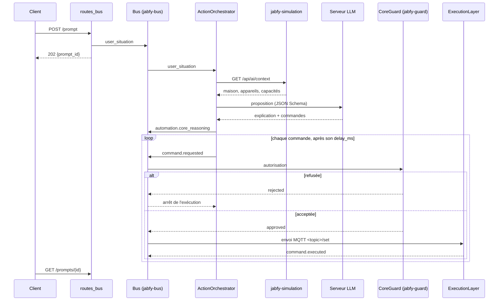

# Fonctionnement interne

## Parcours d'une demande

Une exécution démarre aussi sans client : si `JABFY_HEADLESS_MODEL` est défini, un changement de valeur sur une entité `binary_sensor` (mouvement, contact de porte, fuite…) publie une situation nettoyée sur le bus. Chaque capteur a un délai minimal entre deux déclenchements (`JABFY_HEADLESS_COOLDOWN_SECONDS`).

## Modules

| Module | Rôle |
|---|---|
| `app/main.py` | Crée l'application FastAPI, le CORS, le bus, l'orchestrateur ; monte les routes HTTP et WebSocket |
| `app/api/routes_bus.py` | `/prompt`, `/prompts/{id}`, `/state`, `/audit/verify` |
| `app/api/routes_simulation.py` | `/simulation/home`, `/simulation/propose` |
| `app/api/routes_health.py`, `routes_models.py` | `/health`, `/models` |
| `app/core/bus_runtime.py` | `BusRuntime` : bus, journal d'audit, registre des entités, adaptateur Zigbee2MQTT, moteur de vérification, couche d'exécution |
| `app/core/action_orchestrator.py` | Participant du bus : transforme une situation en appel au modèle, puis publie les commandes une à une |
| `app/core/guard.py` | `CoreGuard` : construit les règles jabfy-guard à partir de `config/bus.json` et de l'inventaire, autorise chaque commande |
| `app/core/run_journal.py` | Garde les 100 dernières exécutions et l'état de chaque étape |
| `app/core/sanitize.py` | Nettoie toute chaîne externe avant qu'elle n'atteigne le modèle |
| `app/core/llm_client.py`, `openai_client.py` | Interface `LLMClient` et implémentation OpenAI-compatible (`httpx`) |
| `app/simulation/client.py`, `planner.py` | Lecture de l'inventaire du simulateur et construction de la proposition |
| `app/schemas/` | Contrats d'API et d'inventaire (pydantic) |
| `config/bus.json` | Politiques de vérification |

Le détail de chaque fichier est dans la [documentation du code](code/README.md).

## Statuts

| Statut d'exécution | Sens |
|---|---|
| `queued` | En attente du worker |
| `planning` | Inventaire et appel au modèle en cours |
| `running` | Commandes en cours de publication |
| `completed` | Toutes les commandes ont été exécutées |
| `no_action` | Le modèle n'a proposé aucune commande |
| `rejected` | La vérification a refusé une commande |
| `failed` | Erreur du simulateur, du modèle, du transport ou interne (voir `error`) |

Statuts d'étape : `pending`, `requested`, `approved`, `rejected`, `executed`, `failed`.

## Choix d'implémentation

- **La vérification est une barrière stricte.** Toute commande passe par le `VerificationEngine` de jabfy-bus, qui délègue la décision à `CoreGuard`. Une commande dont la source, l'entité ou le topic sort de l'inventaire est refusée (`guard:UNTRUSTED_TARGET`). Ne pas ajouter de chemin qui contourne cette étape.
- **Refus par défaut.** Seules les politiques de `config/bus.json` autorisent quelque chose : `core_lights_v1` (lumières et interrupteurs) et `core_thermostat_v1` (thermostat). Volets, climatisation, serrures… sont refusés.
- **Une exécution à la fois.** Les exécutions passent par une file bornée (16 tâches) lue par un seul worker. File pleine : `POST /prompt` répond 429.
- **Arrêt au premier refus.** L'orchestrateur s'arrête à la première commande refusée ou en échec ; les suivantes ne sont pas publiées.
- **Séquences temporisées.** Une commande peut porter `delay_ms` (0 à 10 000). Une proposition contient au plus 60 commandes et la somme des délais ne dépasse pas 60 secondes.
- **Les entrées externes sont nettoyées, mais ce n'est pas la garantie.** Noms d'appareils, pièces, états et situations de capteurs sont débarrassés des caractères de contrôle, des marqueurs de gabarit de chat et des blocs Markdown, puis tronqués (200 caractères par champ, 4 000 par message). La garantie reste la vérification.
- **Sortie structurée.** Le modèle reçoit le JSON Schema de la proposition dans `response_format`, avec une température de zéro. La proposition entière est ensuite contrôlée contre les capacités et les schémas de paramètres des appareils : une commande invalide rejette toute la proposition.
- **Inventaire tolérant aux pannes.** Au démarrage, jabfy-core tente d'enregistrer l'inventaire du simulateur ; en cas d'échec il le signale et réessaie à chaque exécution.
- **Le client LLM est remplaçable.** `LLMClient` est un `Protocol`, le backend se choisit avec `JABFY_LLM_PROVIDER`, et le transport `httpx` est injectable pour les tests. Certains serveurs (llama.cpp) renvoient HTTP 200 avec un corps `{"error": …}` : c'est traité comme une erreur.
