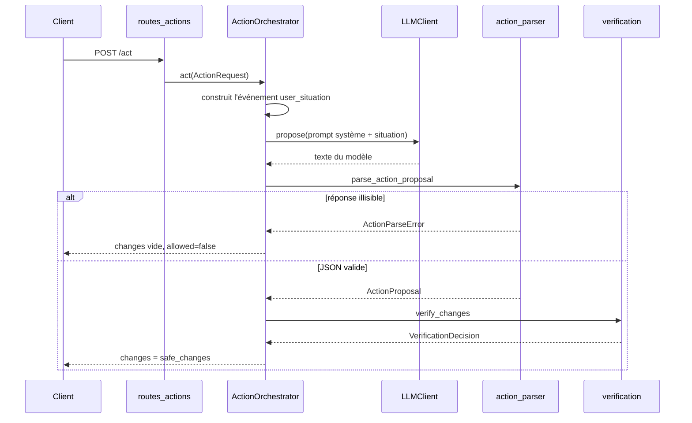

# Fonctionnement interne

## Parcours d'une requête



## Modules

| Module | Rôle |
|---|---|
| `app/main.py` | Crée l'application FastAPI, le CORS, le client LLM et l'orchestrateur |
| `app/api/` | Routes HTTP : `/health`, `/models`, `/act` |
| `app/core/action_orchestrator.py` | Enchaîne événement, appel modèle, parsing, vérification |
| `app/core/prompt_builder.py` | Prompt système (liste des appareils, règles) et message utilisateur |
| `app/core/llm_client.py`, `openai_client.py` | Interface `LLMClient` et implémentation OpenAI-compatible (`httpx`) |
| `app/core/action_parser.py` | Extrait le premier objet JSON valide de la réponse du modèle |
| `app/core/verification.py` | Vérificateur déterministe |
| `app/schemas/` | Contrats d'API et du mini-bus (pydantic) |
| `app/simulation/smart_home_devices.py` | Registre des appareils supportés |

## Choix d'implémentation

- **Le vérificateur est une barrière stricte.** `verify_changes` refuse toute la proposition si un appareil est absent du registre ou si une valeur n'est pas un vrai booléen. Seuls les `safe_changes` arrivent dans le champ `changes` de la réponse. Ne pas ajouter de chemin qui contourne cette étape.
- **Le parseur est tolérant, la vérification ne l'est pas.** Les blocs Markdown (```` ```json ````) sont retirés, puis le premier objet JSON décodable est pris. Un échec de parsing donne une réponse `allowed: false`, pas une erreur HTTP.
- **Le client LLM est remplaçable.** `LLMClient` est un `Protocol`, le backend se choisit avec `JABFY_LLM_PROVIDER`, et le transport `httpx` est injectable pour les tests.
- **Erreurs backend.** Toute panne réseau ou protocole devient `LLMClientError`. `/act` répond alors 502, `/models` répond `available: false`. Certains serveurs (llama.cpp) renvoient HTTP 200 avec un corps `{"error": …}` : c'est traité comme une erreur.
- **Paramètres de génération.** Un champ omis n'est pas envoyé au serveur, qui applique son défaut.
